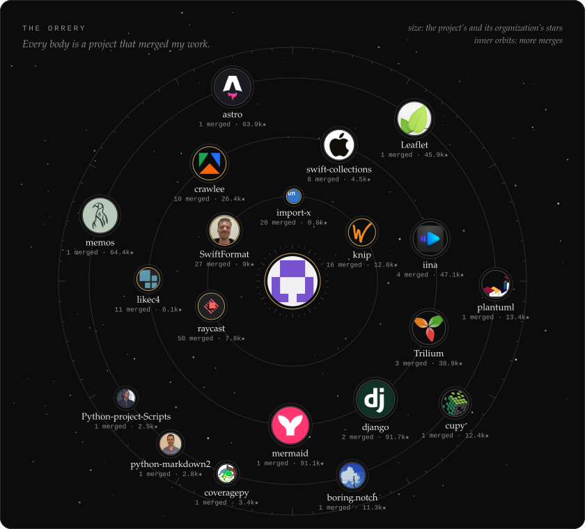
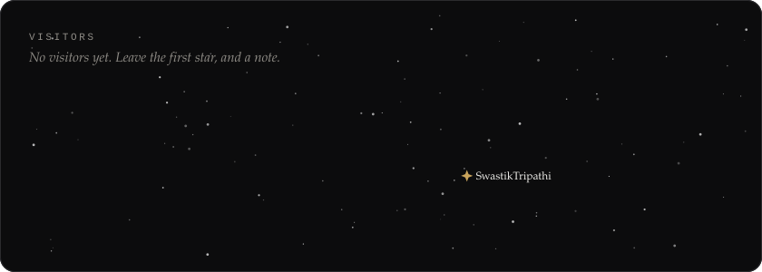

<!-- Generated by build/build.py (classy edition). Edit that, not this file: it is rebuilt every 6 hours. -->

   

<b>Open the boards</b>: every pull request above, with links

 

**Recently merged**

| | Project | Pull request | Merged |
|:-:|---|---|---|
|  | plantuml/plantuml | [🐛 Place a note written after a folder line under that folder in @startfiles](https://github.com/plantuml/plantuml/pull/3007) | Nov 13 |
|  | apify/crawlee | [fix(utils): parse sitemaps whose elements use a namespace prefix](https://github.com/apify/crawlee/pull/4393) | Nov 13 |
|  | apify/crawlee | [fix(utils): ignore microdata inside &lt;template> elements](https://github.com/apify/crawlee/pull/4400) | Nov 13 |
|  | apify/crawlee | [fix(utils): skip &lt;template> content in htmlToText](https://github.com/apify/crawlee/pull/4399) | Nov 13 |
|  | plantuml/plantuml | [🐛 Allow declaring a metaclass, protocol, struct, exception, stereotype or entity after its first use](https://github.com/plantuml/plantuml/pull/3006) | Nov 13 |
|  | raycast/extensions | [[Himalaya] Support Himalaya CLI v2](https://github.com/raycast/extensions/pull/33314) | Nov 13 |
|  | raycast/extensions | [[Iridium] Fix history search with apostrophes](https://github.com/raycast/extensions/pull/33291) | Nov 13 |

**Open pull requests**

| | Project | Pull request | Opened | Review |
|:-:|---|---|---|---|
|  | excalidraw/excalidraw | [fix(editor): don't snap dragged frames to their children's old positions](https://github.com/excalidraw/excalidraw/pull/12166) | Sep 25 | Reviewing |
|  | mermaid-js/mermaid | [fix(xychart): label each bar series with its own values when showDataLabel is true](https://github.com/mermaid-js/mermaid/pull/8521) | Oct 23 | Approved |
|  | mermaid-js/mermaid | [fix(commonDb): decode HTML entities in title and accessibility text](https://github.com/mermaid-js/mermaid/pull/8560) | Oct 26 | Approved |
|  | slidevjs/slidev | [docs: add Cloudflare Workers to the hosting guide](https://github.com/slidevjs/slidev/pull/2830) | Nov 9 | Open |
|  | jestjs/jest | [fix(expect): include iterableEquality in ArrayContaining, ArrayOf, ObjectContaining](https://github.com/jestjs/jest/pull/16512) | Oct 20 | Open |
|  | ManimCommunity/manim | [Fix ManimColor.from_hsv and from_hsl with integer components](https://github.com/ManimCommunity/manim/pull/5126) | Nov 11 | Reviewing |
|  | drizzle-team/drizzle-orm | [fix(sqlite-core): place WHERE before DO NOTHING in onConflictDoNothing](https://github.com/drizzle-team/drizzle-orm/pull/6551) | Oct 20 | Open |

 
Click, write a short note if you like, and press <b>Create</b>. A GitHub Action puts your star in the sky within a minute; notes appear once I've read them.

Rebuilt every six hours from the GitHub API by <a href="../build/build.py">build/build.py</a> · last rebuilt Nov 13, 2026 · also in the <a href="../alt/README-retro.md">retro</a> and <a href="../alt/README-paper.md">paper</a> and <a href="../README.md">github</a> editions

