<!-- Generated by build/build.py (paper edition). Edit that, not this file: it is rebuilt every 6 hours. -->

   

<b>Open the boards</b>: every pull request above, with links

 

**Recently merged**

| | Project | Pull request | Merged |
|:-:|---|---|---|
|  | raycast/extensions | [[Media Converter] Fix WebP and AVIF with FFmpeg builds that lack libwebp or libaom-av1](https://github.com/raycast/extensions/pull/33225) | Nov 11 |
|  | raycast/extensions | [[Browser History] Fix history search with apostrophes](https://github.com/raycast/extensions/pull/33161) | Nov 11 |
|  | apple/swift-collections | [[BasicContainers] Un-deprecate withKeys while keys is miscompiled](https://github.com/apple/swift-collections/pull/844) | Nov 10 |
|  | nicklockwood/SwiftFormat | [Fix comparison before a generic type member being read as a generic](https://github.com/nicklockwood/SwiftFormat/pull/2900) | Nov 10 |
|  | raycast/extensions | [[Zoo] Upgrade openai from v4 to v7](https://github.com/raycast/extensions/pull/33292) | Nov 10 |
|  | coveragepy/coveragepy | [fix: restart coverage from parent config in patch=fork child process](https://github.com/coveragepy/coveragepy/pull/2342) | Nov 10 |
|  | nicklockwood/SwiftFormat | [Fix `&lt;&lt;` before an implicit member being read as a generic](https://github.com/nicklockwood/SwiftFormat/pull/2899) | Nov 10 |

**Open pull requests**

| | Project | Pull request | Opened | Review |
|:-:|---|---|---|---|
|  | excalidraw/excalidraw | [fix(editor): don't snap dragged frames to their children's old positions](https://github.com/excalidraw/excalidraw/pull/12166) | Sep 25 | Reviewing |
|  | mermaid-js/mermaid | [fix(xychart): label each bar series with its own values when showDataLabel is true](https://github.com/mermaid-js/mermaid/pull/8521) | Oct 23 | Approved |
|  | mermaid-js/mermaid | [fix(commonDb): decode HTML entities in title and accessibility text](https://github.com/mermaid-js/mermaid/pull/8560) | Oct 26 | Approved |
|  | slidevjs/slidev | [docs: add Cloudflare Workers to the hosting guide](https://github.com/slidevjs/slidev/pull/2830) | Nov 9 | Open |
|  | Leaflet/Leaflet | [Fix NaN distance between antipodal points](https://github.com/Leaflet/Leaflet/pull/10561) | Nov 11 | Reviewing |
|  | jestjs/jest | [fix(expect): include iterableEquality in ArrayContaining, ArrayOf, ObjectContaining](https://github.com/jestjs/jest/pull/16512) | Oct 20 | Open |
|  | ManimCommunity/manim | [Fix ManimColor.from_hsv and from_hsl with integer components](https://github.com/ManimCommunity/manim/pull/5126) | Nov 11 | Reviewing |

 
Click, write a short note if you like, and press <b>Create</b>. A GitHub Action puts your star in the sky within a minute; notes appear once I've read them.

Rebuilt every six hours from the GitHub API by <a href="../build/build.py">build/build.py</a> · last rebuilt Nov 11, 2026 · also in the <a href="../alt/README-classy.md">classy</a> and <a href="../alt/README-retro.md">retro</a> and <a href="../README.md">github</a> editions

