<!-- Generated by build/build.py (paper edition). Edit that, not this file: it is rebuilt every 6 hours. -->

   

<b>Open the boards</b>: every pull request above, with links

 

**Recently merged**

| | Project | Pull request | Merged |
|:-:|---|---|---|
|  | TriliumNext/Trilium | [fix(client): show 1 km instead of 1,000 m for distances that round up](https://github.com/TriliumNext/Trilium/pull/12672) | Nov 16 |
|  | raycast/extensions | [[Drafts] Fix search with apostrophes and single-line titles](https://github.com/raycast/extensions/pull/33366) | Nov 16 |
|  | raycast/extensions | [[Comet] Fix history search with underscores, percent signs and quotes](https://github.com/raycast/extensions/pull/33443) | Nov 16 |
|  | playcanvas/engine | [Fix Color.toString alpha when it rounds up to 0x10](https://github.com/playcanvas/engine/pull/10032) | Nov 16 |
|  | BabylonJS/Babylon.js | [Decode base64 data URLs as UTF-8 when loading text](https://github.com/BabylonJS/Babylon.js/pull/19169) | Nov 16 |
|  | un-ts/eslint-plugin-import-x | [feat(no-useless-path-segments): report useless index in aliased imports](https://github.com/un-ts/eslint-plugin-import-x/pull/596) | Nov 16 |
|  | mrdoob/three.js | [Color: Keep the hue of the other color in `lerpHSL()` when one is gray.](https://github.com/mrdoob/three.js/pull/35544) | Nov 16 |

**Open pull requests**

| | Project | Pull request | Opened | Review |
|:-:|---|---|---|---|
|  | excalidraw/excalidraw | [fix(editor): don't snap dragged frames to their children's old positions](https://github.com/excalidraw/excalidraw/pull/12166) | Sep 25 | Reviewing |
|  | mermaid-js/mermaid | [fix(xychart): label each bar series with its own values when showDataLabel is true](https://github.com/mermaid-js/mermaid/pull/8521) | Oct 23 | Approved |
|  | mermaid-js/mermaid | [fix(commonDb): decode HTML entities in title and accessibility text](https://github.com/mermaid-js/mermaid/pull/8560) | Oct 26 | Approved |
|  | usememos/memos | [fix(web): show 1.0 MB instead of 1024.0 KB at file size unit boundaries](https://github.com/usememos/memos/pull/6560) | Nov 14 | Reviewing |
|  | slidevjs/slidev | [docs: add Cloudflare Workers to the hosting guide](https://github.com/slidevjs/slidev/pull/2830) | Nov 9 | Open |
|  | pixijs/pixijs | [fix: round Color components to the nearest byte in toNumber and toHex](https://github.com/pixijs/pixijs/pull/12400) | Nov 14 | Approved |
|  | exo-explore/exo | [fix(dashboard): show 1 MB instead of 1024 KB in byte sizes](https://github.com/exo-explore/exo/pull/2616) | Nov 15 | Reviewing |

 
Click, write a short note if you like, and press <b>Create</b>. A GitHub Action puts your star in the sky within a minute; notes appear once I've read them.

Rebuilt every six hours from the GitHub API by <a href="../build/build.py">build/build.py</a> · last rebuilt Nov 17, 2026 · also in the <a href="../alt/README-classy.md">classy</a> and <a href="../alt/README-retro.md">retro</a> and <a href="../README.md">github</a> editions

